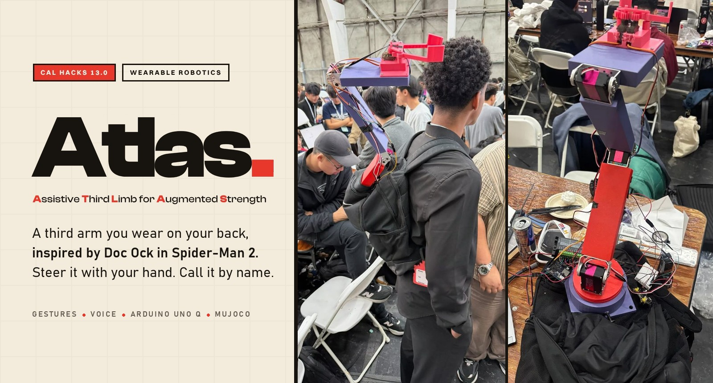
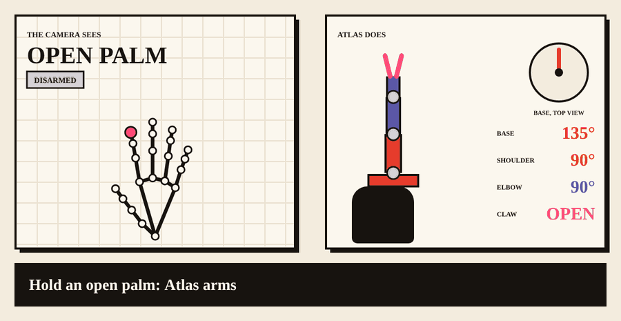
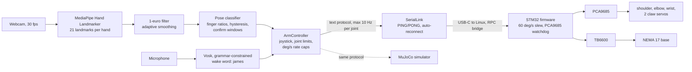
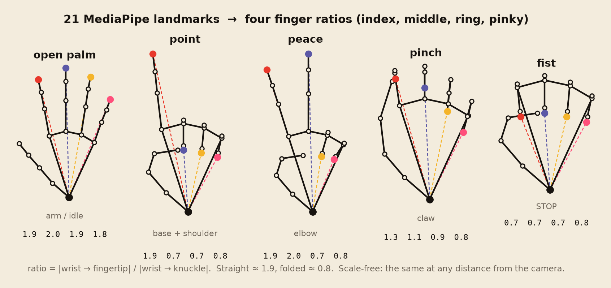
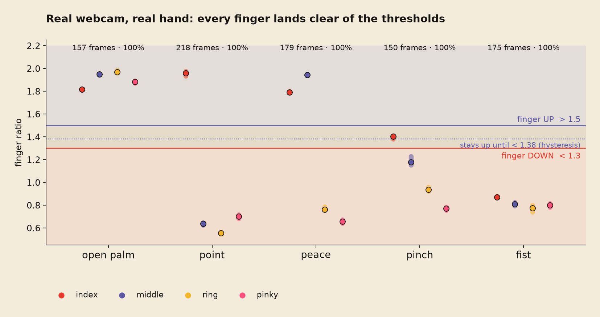
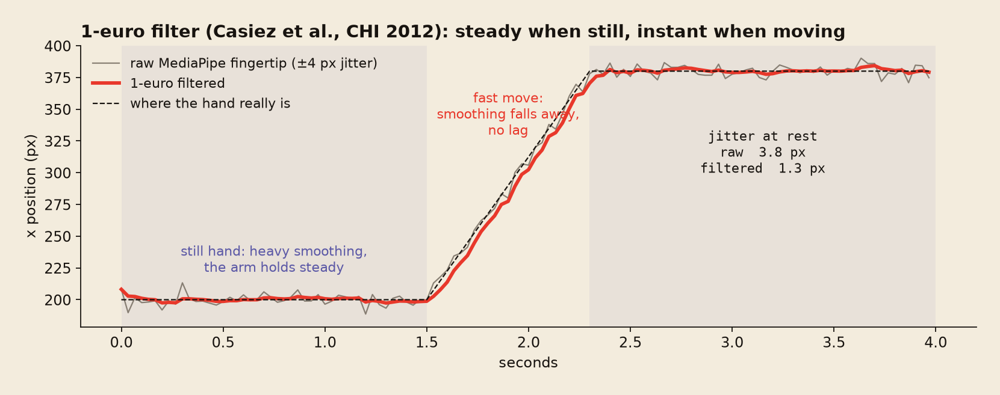
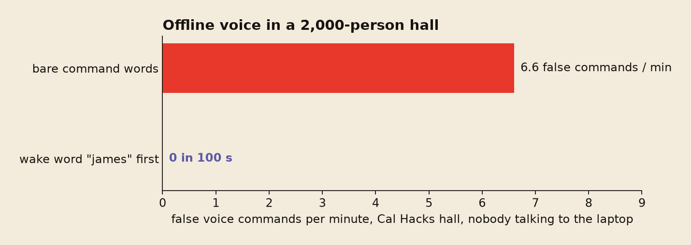

<p align="center"></p>

<p align="center">
<a href="https://mlh.io"></a>
<a href="https://github.com/JacobHailemariam/james-gestures/actions/workflows/tests.yml"></a>


</p>

<h3 align="center">An extra arm you wear on your back, steered by your hand and your voice.</h3>

> **Built at [Cal Hacks 13.0](https://cal-hacks-13-0.devpost.com/), an MLH hackathon** in San Francisco,
> October 23 to 25, 2026, by a team of four. Everything here was written that weekend (the vision and voice
> pipeline, the controller, the Arduino firmware, the simulator and the test suite), on top of two open-source
> (MIT) gesture modules vendored from the JAMES project.

**Atlas** (Assistive Third Limb for Augmented Strength) is a 4-joint robotic arm with a geared claw, mounted on a
backpack. A laptop webcam watches one hand and a microphone listens for a wake word. No joystick, no gloves, no
body-worn sensors. It is for people who need a hand they don't have: someone recovering from an injury or living
with limited mobility, or anyone whose job asks their shoulders to lift all day.

<p align="center"></p>
<p align="center"><sub>Rendered from the real <code>GestureReader</code> and <code>ArmController</code>. Every number and serial line shown is what the code produced.</sub></p>

## At a glance

| | |
|:--|:--|
| **Gesture recognition, real webcam** | 5 gestures, 879 labelled frames, **100%** recognised ([data](docs/data/hands_webcam.csv)) |
| **Robustness sweep** | 27 hand placements x 7 noise levels: 100% for every pose up to 4% landmark jitter |
| **Voice false alarms** | 6.6 per minute in a 2,000-person hall, **0 in 100 s** with the wake word |
| **Reaction time** | STOP 0.37 s after a fist; arming needs a deliberate 1 s open palm, 0 false arms |
| **Perception cost** | 17 ms per frame for MediaPipe on a laptop CPU, so 30 fps end to end |
| **Tests** | 81 unit and integration tests, run in CI on every push |

## How it works



Five layers, each testable on its own. The laptop does perception and decisions; the board only executes a
seven-command text protocol, so the simulator can stand in for it unchanged.

| Layer | What it does | Code |
|:--|:--|:--|
| Perception | Webcam frame to the driving hand's 21 landmarks; ignores bystanders' hands | [`tracker.py`](james_gestures/tracker.py) |
| Gesture ML | Landmarks to smoothed, confirmed gestures | [`handpose.py`](james_gestures/handpose.py), [`motion.py`](james_gestures/motion.py), [`gestures.py`](james_gestures/gestures.py) |
| Voice | Offline speech to commands, with a wake word and a health monitor | [`voice.py`](james_gestures/voice.py) |
| Control | Gestures and voice to safe joint targets; presets; the serial link | [`arm.py`](james_gestures/arm.py) |
| Firmware | Commands to PWM pulses and stepper steps on the Arduino UNO Q | [`arm_receiver_unoq.ino`](firmware/arm_receiver_unoq/arm_receiver_unoq.ino) |
| Simulation | MuJoCo model of the arm on the backpack, plus a pose solver | [`sim.py`](james_gestures/sim.py), [`arm.xml`](sim/arm.xml), [`solve_poses.py`](tools/solve_poses.py) |

## The machine learning

### From pixels to poses

<p align="center"></p>

A pretrained neural network, Google's **MediaPipe Hand Landmarker**, turns each frame into 21 landmarks. On top of
that sits a small, deliberate feature model rather than a second trained classifier:

- **Scale-free features.** Each finger is one number: wrist-to-tip distance over wrist-to-knuckle distance. About
  1.9 when straight, about 0.8 when folded, and the same whether the hand is 40 cm or 2 m from the camera.
- **Hysteresis.** A finger turns "up" above 1.50 but only turns back "down" below 1.38, so a ratio hovering near
  one threshold can't flicker between poses.
- **Confirm windows.** A pose must be seen for 50 to 150 ms before it counts, so one noisy frame changes nothing.
- **Context rules.** A pinch that starts inside a fist is not a pinch, so closing your hand never fires the claw.

Why not train a classifier? With a weekend and no labelled dataset, a geometric model was the honest choice: it
needs no training data, it is deterministic and debuggable, every threshold is a named constant, and it can be
unit-tested with synthetic hands. The real-webcam measurement below is what justified keeping it.

### Measured on a real hand

<p align="center"></p>

Recorded with `demo.py --log` and summarised by [`tools/tune_hands.py`](tools/tune_hands.py): every finger of every
gesture lands well clear of its threshold, and all 879 labelled frames were classified correctly. The tightest
margin, the pinching index finger against the fist rule, is still about 0.3.

### Stress-tested before it touched hardware

[`tools/eval_gestures.py`](tools/eval_gestures.py) feeds synthetic hands through the real reader and controller:
3 hand sizes x 3 positions x 3 rotations, with Gaussian landmark jitter from 0 to 25% of palm size, both white and
slowly drifting.

| Landmark jitter | open | point | peace | pinch | fist | false ARM | STOP latency |
|:--|:--:|:--:|:--:|:--:|:--:|:--:|:--:|
| 0 to 4% | 100% | 100% | 100% | 100% | 100% | 0 | 0.37 s |
| 8% | 100% | 100% | 100% | 87.7% | 100% | 0 | 0.37 s |

The sweep earned its keep: it found that one noisy frame during a held pinch could release the claw and drop
whatever it held, in **16 of 27** trials under slow drift. The controller now opens the claw only when the
thumb-index gap really widens, and the same sweep measures **0 of 27**.

### Smoothing that doesn't lag

<p align="center"></p>

Raw landmarks shake by a few pixels even on a still hand. A fixed low-pass filter would trade that jitter for lag.
The **1-euro filter** (Casiez, Roussel and Vogel, CHI 2012) adapts its cutoff to speed: heavy smoothing at rest,
almost none in a fast move.

### Voice in a 2,000-person hall

<p align="center"></p>

Speech runs offline with **Vosk**, constrained to a grammar of 27 command phrases plus the wake word. The first measurement in the hall was 6.6
false commands per minute, at confidence 0.8 to 1.0, so raising a threshold could not fix it. Requiring the wake
word "james" took it to zero. "james stop" acts mid-sentence, but only after two consecutive partial results agree,
because single-partial "stops" were the most common noise artifact. If the mic stream dies, a health check notices
within 2 s, shows **VOICE DOWN** and reopens the mic.

## Control and safety

| You do | Atlas does |
|:--|:--|
| ✋ **Open palm**, held 1 s | Arms. It is also the "hold still" pose |
| ☝️ **Point** and move | Left/right turns the **base**, up/down lifts the **shoulder** |
| ✌️ **Peace sign** and move | Up/down bends the **elbow** |
| 🤏 **Pinch** / release | The **claw** closes / opens |
| ✊ **Fist** | **STOP**: everything freezes and disarms |
| 🗣️ "**james** home / raise / grab / left shoulder / stop" | Voice presets and commands |

Steering works like a joystick, not a mirror: where you start pointing is zero and the offset sets the speed, so a
lean or a tremor can't snap a joint. Safety is layered on both sides of the cable:

- **Laptop:** joint limits and per-joint deg/s caps; the stick locks to one axis per move and times out after 3 s;
  losing sight of the hand for 2 s disarms.
- **Firmware:** every servo slews at most 60 deg/s; servos power up one at a time so their inrush can't brown out
  the board; a watchdog re-initialises the PWM chip if a power dip reset it; the stepper driver is enabled only
  while the base moves.
- **Link:** the laptop PINGs on connect, notices a dropped or rebooted board, disarms, and reconnects by itself.

## Embedded: the other half of the stack

The Arduino UNO Q has two processors: a Linux SoC that owns the USB port and an STM32 microcontroller that drives
the motors. Commands travel laptop to Linux to an RPC bridge to the MCU. Two consequences shaped the design:

- **Bandwidth is precious.** Sending a position every camera frame made the arm lag by seconds as the bridge
  backed up. The controller now sends each joint at most 10 times per second, always ending on the exact
  target, and the firmware's slew interpolates between updates.
- **Failures are silent by default.** A board that reboots, or a PWM chip that resets on a power dip, still
  looks healthy over the wire. Both are now detected and reported on the HUD.

The protocol is deliberately tiny, so anything that speaks it can drive the arm:

```
PING -> PONG | ARM 1 | ARM 0 | STOP | J <base|shoulder|elbow|wrist> <deg> | CLAW 1 | CLAW 0
```

[`tools/flash_unoq.py`](tools/flash_unoq.py) pushes the sketch to the board over adb, restarts it and waits for PONG.

## Simulation and kinematics

The MuJoCo model in [`sim/arm.xml`](sim/arm.xml) puts the arm on a model of our backpack, with link lengths read
from the team's SolidWorks export in [`cad/`](cad/). The simulator speaks the same protocol as the board, so
`demo.py --sim` drives it with no hardware. [`tools/solve_poses.py`](tools/solve_poses.py) computes the voice
presets ("james left shoulder", "james right hip") by searching joint space for a pose that puts the fingertip on a
target without any link passing through the bag.

## Engineering practice

- **81 tests** with synthetic hands, a fake serial port, a fake microphone and a headless simulator, so the whole
  pipeline is tested without a camera or an arm. CI runs them on Python 3.11 and 3.12.
- **Measurement tools** for each risky assumption: [`eval_gestures.py`](tools/eval_gestures.py),
  [`eval_voice.py`](tools/eval_voice.py), [`tune_hands.py`](tools/tune_hands.py), and
  [`make_readme_figures.py`](tools/make_readme_figures.py), which draws every figure here from the code and data.
- **Written debugging.** Every hardware failure got a reproducible write-up with measured evidence: see the
  issue log ([`docs/ISSUES.md`](docs/ISSUES.md)) and one investigation end to end
  ([`docs/NOTHING_MOVES.md`](docs/NOTHING_MOVES.md)).

## Try it without hardware

```bash
git clone https://github.com/JacobHailemariam/james-gestures.git
cd james-gestures
python -m venv .venv && source .venv/bin/activate        # Windows: .venv\Scripts\activate
pip install -r requirements.txt -r requirements-voice.txt mujoco
python -m pytest -q                                      # 81 tests, no camera needed
python demo.py --sim --voice                             # your webcam and mic drive the 3D arm
```

With the board connected: `python demo.py --port COM3 --voice`. Every flag, the wiring, troubleshooting and tuning
are in [`docs/ENGINEERING.md`](docs/ENGINEERING.md).

## Repository map

```
james_gestures/      the Python package
  tracker.py           MediaPipe wrapper, picks the driving hand
  handpose.py          finger ratios, pose classifier with hysteresis    (from JAMES)
  motion.py            1-euro filter, swipe and trail helpers           (from JAMES)
  gestures.py          one GestureFrame per camera frame
  arm.py               ArmController, presets, SerialLink
  voice.py             offline voice with wake word and health checks
  sim.py               MuJoCo stand-in for the board
demo.py              the app: camera window, HUD, voice, keys
firmware/            UNO Q receiver and a one-at-a-time hardware check
sim/, cad/           MuJoCo model and the SolidWorks assembly
tools/               evaluation, tuning, pose solving, flashing, figures
tests/               81 tests
docs/                engineering notes, issue log, a debugging write-up, measured data
```

## What we learned the hard way

- **Synthetic tests are not real hands.** Our first real-webcam log looked like 17 to 56% accuracy. The logger
  showed it was mislabelled transitions, not the classifier, and a clean run was 100%. Measure before tuning.
- **Bare voice commands fail in a crowd.** Confidence scores don't help when noise scores 0.9; a wake word does.
- **Hardware fails silently.** A power dip resets a PWM chip that still answers on I2C. Every layer now reports
  its own health instead of assuming it.
- **Our first arm design couldn't hold its motors.** We redesigned around the real joint torques and reprinted.

## Who built what

**Jacob Hailemariam** wrote the software and electronics side of Atlas:

- **Firmware** for the Arduino UNO Q: the command protocol, servo pulse mapping for 270-degree servos, the
  60 deg/s slew limiter, the lazy stepper enable, the claw and wrist handling, and the hardware bring-up sketch.
- **Controller** ([`arm.py`](james_gestures/arm.py)): the point/peace joystick, joint limits and rate caps,
  axis lock and move window, the claw-release fix found by the robustness sweep, voice presets and pose saving.
- **Serial link**: PING handshake, board-loss detection and auto-reconnect, and the 10 Hz send cap that cured
  the multi-second lag.
- **Voice**: the wake word, grammar and two-partial stop rule, with the measurement tool that justified them.
- **Simulation**: the MuJoCo model of the arm on the backpack, link lengths from the CAD, and the pose solver.
- **Tooling and tests**: the gesture robustness sweep, flashing over adb, the README figures, CI, and most of
  the 81 tests.
- **Wiring and bring-up** of the PCA9685, the TB6600 and the UNO Q on the real arm.

## Team

| | |
|:--|:--|
| **Victor Espinoza** · UC Davis | Arm design, CAD, motors |
| **Jacob Hailemariam** · University of Calgary | Embedded, firmware, control software |
| **Semir Haji** · University of Calgary | Mechanical build, printing |

---

MIT licensed, see [LICENSE](LICENSE). `james_gestures/handpose.py` and `james_gestures/motion.py` are vendored
unchanged from the open-source JAMES project under its MIT license; their copyright notice is in each file's header.
MediaPipe hand model: Google, Apache 2.0. Vosk: Alpha Cephei, Apache 2.0.
