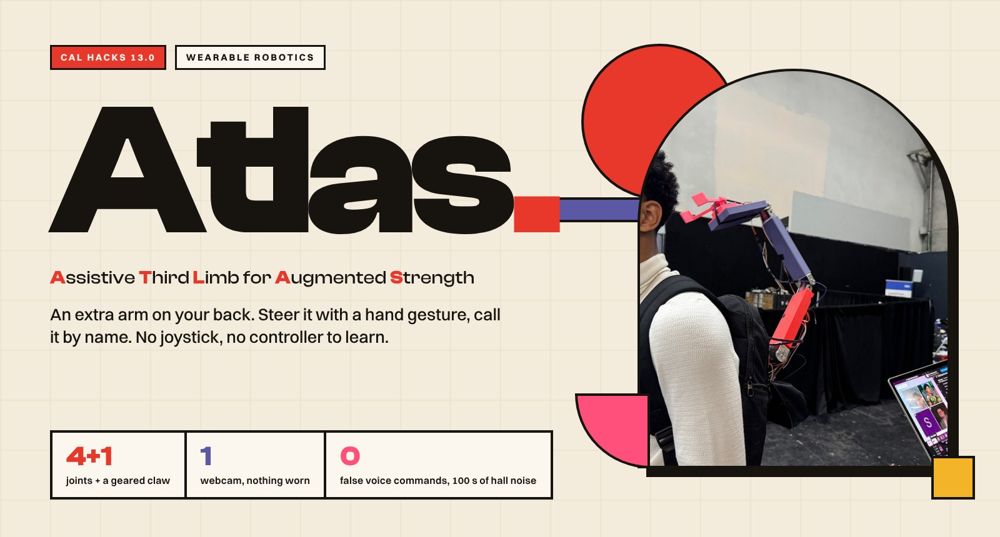
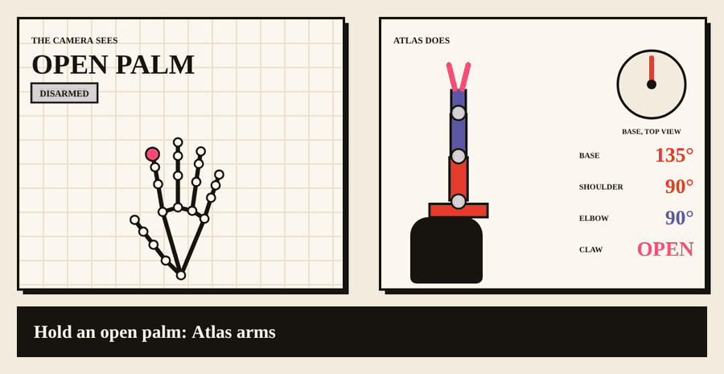
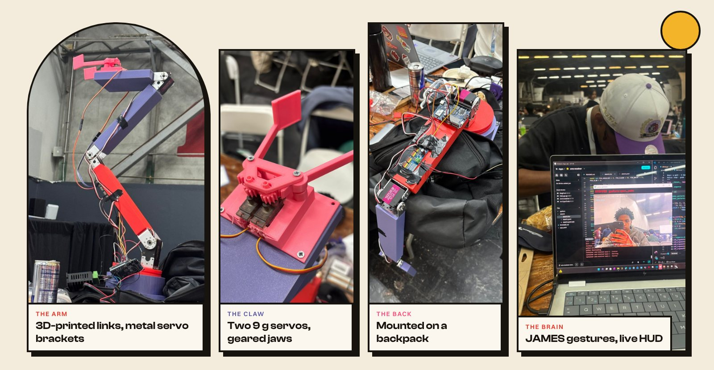
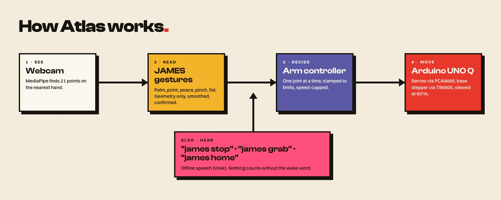

<p align="center"></p>

<p align="center">


</p>

<h3 align="center">Carrying the weight of the world? Atlas takes some of it off your shoulders.</h3>

**Atlas** is an extra arm you wear on your back. A webcam watches your hand, and a few simple gestures steer
the arm one joint at a time: point to turn and lift, make a peace sign to bend the elbow, pinch to close the
claw, make a fist to stop everything. Say "james" and a word and it listens too. No joystick, no
body-worn sensors, nothing to learn.

We built it for people who need a hand they don't have: someone recovering from an injury or living with
limited mobility, and anyone whose job asks their shoulders and back to lift all day.

<p align="center"></p>
<p align="center"><sub>Rendered from the real <code>GestureReader</code> and <code>ArmController</code>, fed synthetic hands. Every number and every serial line on the right is what the code produced.</sub></p>

## Drive it

| You do | Atlas does |
|:--|:--|
| ✋ **Open palm**, held 1 s | Arms. It is also the "hold still" pose |
| ☝️ **Point** and move your hand | Left / right turns the **base**, up / down lifts the **shoulder** |
| ✌️ **Peace sign** and move | Up / down bends the **elbow** |
| 🤏 **Pinch** / release | The **claw** closes / opens |
| ✊ **Fist** | **STOP**: everything freezes and disarms |
| 🗣️ "**james** home / raise / grab / stop" | Voice, offline. Nothing counts without the wake word |

It works like a joystick, not a mirror: where you start pointing is zero, and how far you move from it sets
the speed. A jittery hand can't snap a joint, because every target is clamped to its limits and speed-capped,
and the board slews every servo at 60°/s on top of that.

## The build

<p align="center"></p>

| Part | What we used |
|:--|:--|
| **Base** | NEMA 17 stepper on a TB6600 driver, turntable printed in PLA |
| **Shoulder** | ANNIMOS RDS5160SG, 60 kg·cm servo (red link) |
| **Elbow, wrist** | ANNIMOS RDS3225SG, 25 kg·cm servos (violet links) |
| **Claw** | Two 9 g servos driving geared jaws (pink) |
| **Brain** | Arduino UNO Q, PCA9685 16-channel PWM board |
| **Mount** | A backpack, so the arm rides on your back |
| **Design** | SolidWorks CAD, 3D printed; joint torque sized the motors and link lengths |
| **Software** | Python, MediaPipe, OpenCV, Vosk, MuJoCo sim, JAMES gesture stack |

<p align="center"></p>

## What we learned the hard way

- **Our first design looked great and couldn't hold its motors.** We scrapped it and redesigned around the
  real torques, then reprinted.
- **Bare voice commands fail in a hackathon hall.** We measured 6.6 false commands a minute from crowd noise.
  Requiring the wake word "james" took that to 0 in 100 seconds.
- **Sending every camera frame to the board made the arm lag by seconds.** Capping joint updates at 10 per
  second per joint fixed it.
- **The board reset whenever the motors drew power.** The real fix is electrical (motors on their own supply),
  and the software already notices a reboot, disarms the arm and reconnects by itself.

## What's next

EMG muscle-signal control, a proper back harness with onboard power, force sensing, lighter and stronger
materials, and testing with physical therapists and real users.

## Team

| | |
|:--|:--|
| **Victor Espinoza** · UC Davis | Arm design, CAD, motors |
| **Jacob Hailemariam** · University of Calgary | Embedded, firmware, control software |
| **Semir Haji** · University of Calgary | Mechanical build, printing |
| **Victor Isaac** · ACE Engineering College, Hyderabad (remote) | JAMES gesture system |

---

<details>
<summary><b>Engineering notes</b>: how to run it, every flag, wiring, protocol, troubleshooting</summary>

```
webcam -> MediaPipe (21 hand points) -> GestureReader -> ArmController -> serial -> arm_receiver_unoq.ino -> motors
mic    -> Vosk (offline)             -> VoiceListener  ---^
```

## Run it (Windows, 5 minutes)

```bat
python -m venv .venv
.venv\Scripts\pip.exe install -r requirements.txt
.venv\Scripts\pip.exe install -r requirements-voice.txt     :: only if you want --voice
.venv\Scripts\python.exe -m pytest -q tests                  :: 35 tests, synthetic hands, no camera or mic
.venv\Scripts\python.exe demo.py                             :: dry run: prints commands, nothing moves
.venv\Scripts\python.exe check_board.py COM3                 :: sends PING, expects PONG, moves nothing
.venv\Scripts\python.exe demo.py --port COM3 --camera 1 --voice
```

Mac / Linux: `python3 -m venv .venv && source .venv/bin/activate`, then the same commands with `python`.
The port is `/dev/tty.usbmodemXXXX` on Mac, usually `/dev/ttyACM0` on Linux.

`hand_landmarker.task` (Google's MediaPipe hand model) is in the repo, nothing to download for the camera side.

### demo.py flags

| Flag | What it does |
|---|---|
| `--port COM3` | serial port of the board. Omit for a dry run that only prints commands |
| `--baud 115200` | serial speed (default 115200) |
| `--camera 1` | which webcam (default 0) |
| `--model hand_landmarker.task` | path to the MediaPipe hand model |
| `--voice` | also listen for voice commands (offline, Vosk) |
| `--vosk-model <folder>` | an unzipped Vosk model folder. Default: auto-download the small English model |
| `--mic 2` | microphone device number (default: system default) |
| `--no-pinch-claw` | pinch does nothing; the claw is voice-only |
| `--sim` | drive a MuJoCo model of the arm (`pip install mujoco`). With `--port` too, the sim shows what the real arm was told |
| `--speed 2` | multiply every joint's max speed |
| `--min-hand 0.05` | hands smaller than this fraction of the frame height (people in the background) never drive; 0 = off |
| `--log hands.csv` | record finger ratios per frame; keys 1-5 label the gesture you hold. Summarise with `tools/tune_hands.py hands.csv` |

Keys in the demo window: `q` quit, `space` STOP, `h` `r` `e` `t` presets home / raise / reach / tuck,
`f` follow (hand steers again after a preset).

## Gestures

The arm always starts disarmed. While armed, steering is a joystick that drives one joint at a time:
where you start pointing is the zero, and how far your fingertip is from that zero sets the speed.

| Gesture | Arm does |
|---|---|
| Open palm, held 1 s | **ARM**: motion enabled (also the idle pose: nothing moves) |
| Fist, held 0.3 s | **STOP**: freeze and disarm (soft kill switch) |
| **Point** (1 finger) and move | left/right = **base**, up/down = **shoulder** |
| **Peace** (2 fingers) and move | left/right = **wrist**, up/down = **elbow** |
| Un-point (back to open palm) | that joint stops; pointing again sets a new zero |
| Pinch / release | claw close / open |
| Hand leaves camera | holds still, disarms after 2 s |

Details: the dead zone is 4 % of the frame, full speed at 20 %, and only the larger of the two axes moves.
Hand position is never mapped straight to an angle, so a lean or a jitter can't move the arm.
Only the largest hand in view (closest to the camera) drives; other hands are drawn faded and ignored.
A fist is only a fist when every finger is folded, so a pinch with curled fingers does not trigger STOP.

## Voice

Offline, Vosk small English model. First run with `--voice` downloads it (about 40 MB) into `~/.cache/vosk`,
or pass `--vosk-model <folder>` with the unzipped model. Needs `requirements-voice.txt` (vosk, sounddevice).

**Say "james" first, then the word**: "james stop", "james grab", "james home". Without the wake word nothing
happens. Measured in the Cal Hacks hall with nobody talking to the laptop: bare words gave 6.6 false commands
per minute (noise came back as "release", "raise", "follow", "stop" with confidence 0.8-1.0); with the wake
word the same 100 s of noise gave 0.

| Say | Command | Also heard as |
|---|---|---|
| stop | STOP, works even when disarmed | freeze, halt |
| grab | claw closes | close, grip |
| release | claw opens | open, drop, let go |
| raise | preset: shoulder 150, elbow 120 | lift, up |
| reach | preset: shoulder 110, elbow 40 | forward |
| home | preset: all joints to home | reset |
| tuck | preset: shoulder 30, elbow 150 | rest, down |
| follow | hand steers again after a preset | resume, move |
| left shoulder, right shoulder, left hip, right hip | the four demo poses | |
| save left shoulder (or any pose name) | stores the arm's current angles under that name in `poses.json`, which loads next time | |

The four demo poses ship as placeholders (raise / tuck with the base turned 45 deg) and nobody has measured
them on the real arm. Steer to the real pose in the sim, say "james save left shoulder", repeat for the other
three, and commit `poses.json`.

Voice needs no hand in the picture. If the arm is locked, "james home" (or any claw or preset word) arms it
and goes; "james follow" alone does not. While a hand is driving, losing it for 2 s still disarms; armed by
voice with no hand yet, it simply waits. A preset pauses hand steering until `follow` (or `f`), so the hand
can't drag the arm off the pose, and it keeps playing even if the hand leaves view.
The recogniser only knows these words plus "james"; every word except stop needs a confident match, and
"james stop" is acted on mid-sentence once it has shown up in two consecutive partial results. A voice `grab` is not undone by the next camera frame, and re-arming never opens the claw.

## Safety built in

- Starts disarmed, both in Python and in the firmware. Nothing moves until a deliberate 1 s open palm.
- Firmware: all servo outputs are off at power-up and stay off until the first joint command after `ARM 1`.
  `STOP` / `ARM 0` disable the stepper driver; servos keep their last pulse so the arm holds its pose.
- Every joint target is clamped to its limits and rate-limited in deg/s (`default_joints()` in `arm.py`),
  so a tracking glitch can't snap a joint across its range. Presets obey the same clamps and limits.

| Joint | Limits (deg) | Home | Max speed (deg/s) |
|---|---|---|---|
| base | 0..270 (so cables can't wrap) | 135 | 45 |
| shoulder | 20..160 | 90 | 45 |
| elbow | 20..160 | 90 | 60 |
| wrist | 0..180 | 90 | 90 |

- **This does not replace a hardware kill switch** on the motor power lines. Wire one and keep a hand on it.

## Hardware (UNO Q)

From `firmware/arm_receiver_unoq/arm_receiver_unoq.ino`. The laptop's USB serial reaches the sketch through
`Monitor` (Arduino_RouterBridge); the sketch prints `READY` when it starts.

| Part | Wiring |
|---|---|
| Servos | PCA9685 16-channel PWM board on I2C at `0x40`, 50 Hz. Shoulder ch 4 (ANNIMOS RDS5160SG 60 kg, 6-8.4 V), elbow ch 0 and wrist ch 1 (ANNIMOS RDS3225SG 25 kg, 5-6.8 V), claw ch 15 (9 g). The ANNIMOS servos sweep 270 deg over 500..2500 us, the claw 180 deg; the firmware converts so that protocol degrees are real degrees with 90 = centre. Servo power from the PCA9685 V+ terminal (own supply), ground shared with the board |
| Base stepper | TB6600-style driver: PUL D9, DIR D3, ENA D4 (ENA HIGH = disabled). PUL-/DIR-/ENA- to GND. Driver set to 3200 pulses/rev (1/16) |
| Claw | `CLAW_OPEN = 20`, `CLAW_CLOSED = 95` degrees, tune so closed grips without stalling |

Libraries needed on the board: Adafruit PWM Servo Driver, Adafruit BusIO, Arduino_RouterBridge.
To flash from this folder: `.venv\Scripts\python.exe tools\flash_unoq.py` (board on USB, App Lab installed once for its adb).
Base step 0 is wherever the base was at power-on and is taken as 135 deg (`BASE_HOME_DEG`).

## Serial protocol

One command per line, 115200 baud. The board is a dumb executor; anything that speaks these lines works.

```
PING -> PONG | ARM 1 | ARM 0 | STOP | J <base|shoulder|elbow|wrist> <deg> | CLAW 1 | CLAW 0
```

`J` and `CLAW` are ignored until `ARM 1`. The board answers `OK ARM`, `OK STOP`, `OK DISARM`.

## What is in here

| File | What it is |
|---|---|
| `james_gestures/handpose.py` | From JAMES. Pose tracker (palm / point / pinch / peace) with per-finger hysteresis and confirm times, plus "a pinch that starts in a fist is not a pinch" |
| `james_gestures/motion.py` | From JAMES. 1-euro smoothing, swipe detection, swept hit test |
| `james_gestures/gestures.py` | Combines the above into one `GestureFrame` per camera frame |
| `james_gestures/arm.py` | `ArmController`: gestures and voice -> safe commands. Joint limits, speeds, presets, joystick settings at the top |
| `james_gestures/voice.py` | `VoiceListener`: offline Vosk, word list, confidence filter, early stop |
| `james_gestures/tracker.py` | MediaPipe wrapper: camera frame -> the driving hand's 21 points |
| `james_gestures/sim.py` | `SimLink`: MuJoCo stand-in for the board, same protocol, kinematic only (no physics) |
| `sim/` | MuJoCo model `arm.xml` and the printed-part meshes it uses |
| `demo.py` | Webcam demo with HUD: state, gesture, joint angles, joystick bar, voice readout |
| `check_board.py` | `python check_board.py COM3`: sends PING, waits 3 s for PONG, nothing moves |
| `test_motors.py` | `python test_motors.py COM3`: type `arm`, `shoulder 100`, `elbow +5`, `claw 1`, `home`, `stop`, `quit`. Moves are clamped to the limits in `arm.py` |
| `tools/flash_unoq.py` | Push a sketch to the UNO Q over adb, restart the app there, PING for PONG. Replaces clicking Run in App Lab |
| `firmware/arm_receiver_unoq/` | **The real firmware.** UNO Q sketch: Monitor commands -> PCA9685 servos + TB6600 stepper |
| `firmware/bringup_unoq/` | One-at-a-time hardware check on the UNO Q: `scan` (I2C), `servo` (sweep shoulder), `base` (200 steps out and back), `off`, `help` |
| `firmware/arm_receiver/` | Older classic-Arduino version (Servo library, USB Serial). Not for the UNO Q |
| `tests/test_arm.py` | Poses, noise rejection, arming, stop, claw, speed limits, hand lost, clamping |
| `tests/test_joystick.py` | Point/peace joystick: one joint at a time, dead zone, un-point re-zeroes |
| `tests/test_voice_and_fist.py` | Voice parsing, voice -> arm, pinch-vs-fist |
| `tests/test_serial_link.py` | The serial link survives the board vanishing and only trusts it again after PONG |

## Troubleshooting

- **No PONG** from `check_board.py` after the board lost power: the app on the UNO Q is not running.
  Run `.venv\Scripts\python.exe tools\flash_unoq.py --no-flash` (restarts the app over adb and PINGs),
  or press Run in App Lab.
- **The board reboots the moment `ARM 1` is sent**: power problem. Something on the arm is loading the board's
  supply. Give the TB6600 and the PCA9685 their own supplies and share only ground. The firmware now enables
  the stepper driver only while the base is actually moving, so arming alone should not trip it.
- **Wrong camera**: try `--camera 0`, `1`, `2`. A black image is usually the IR camera.
- **"Failed to create a model"** with `--voice`: point `--vosk-model` at the unzipped model folder.
- **Red "BOARD LOST" line in the demo**: the board dropped off USB or rebooted. The demo disarms, keeps
  running, and reconnects by itself once the board answers PONG. If it never comes back, see "No PONG".

## Tune on the real arm

- `default_joints()` in `arm.py`: each joint's `lo` / `hi` / `home` / `max_speed`. Start slow and raise it.
- `ArmConfig` in `arm.py`: hold times, `stick_dead` / `stick_full` for the joystick feel.
- Firmware: `CLAW_OPEN` / `CLAW_CLOSED`, `STEPS_PER_DEG` (change if the base is geared), `STEP_US` (base speed).
- If pinch is too touchy, raise `GestureConfig.pinch_ratio` in `gestures.py` (0.33 default; higher with gloves).
  The HUD prints the finger ratios and the thumb-index gap so you can see what it measures.

</details>

---

Gesture code: MIT, © 2026 Chintha Victor Isaac (from JAMES, github.com/victorisaacchinta-eng/james;
`handpose.py` and `motion.py` are vendored verbatim). MediaPipe hand model: Google, Apache 2.0.
